# أوربت على iPhone Duo — جودة الامتداد الكامل والتكيّف (13 نوفمبر 2026)

نطاق هذه الجولة طبقة العرض فقط: [src/app.css](../src/app.css) وسطر `theme-color` في [index.html](../index.html). لم يُمَسّ الخادم ولا المصادقة ولا الوضع التجريبي ولا Firestore ولا ملفات النشر ولا غلاف iOS الأصلي.

رموز الحالة: `PASS` تحقق مُشاهد/مُختبر، `PARTIAL` جزئي، `FAIL` خلل باقٍ، `BLOCKED` يحتاج جهازًا أو إذنًا، `NOT_APPLICABLE` غير ذي صلة، `NOT_TESTED` لم يُختبر.

## 1. نوع المشروع ومسار العرض

- **الويب:** React 19 + Vite 8 + Tailwind 4، يخدمه Express ([server.ts](../server.ts)). صفحتان فعليتان: الدخول (`.login-wrap`) ولوحة المدار (`.shell` ثم `Dashboard`). كل الأشكال في ملف واحد [src/app.css](../src/app.css).
- **غلاف iOS:** Capacitor 8 في [apple/](../apple/) يحمّل الموقع الحي (`server.url`) مع `contentInset: never`. المشروع `SDKROOT = iphoneos` (أحدث SDK مثبّت) و`IPHONEOS_DEPLOYMENT_TARGET = 16.0`. على هذا الجهاز Xcode 27.2 وiOS SDK 27.2، فالبناء التالي يكون بـ SDK ≥ 27.1، وهو المسار الرسمي لملء الشاشة الداخلية حتى الحافة. **لم يُبنَ التطبيق في هذه الجولة**، ولم تُغيَّر إعداداته (`NOT_TESTED`).
- **PWA:** يوجد `manifest.json` و`sw.js`، وأغلب ما فيهما خارج هذا النطاق. عُدِّل `theme-color` الداكن وحده (انظر أدناه).

## 2. خط الأساس قبل التعديل (`origin/main` = `7d2bf0f`)

| الفحص | النتيجة |
|---|---|
| `npm ci` | PASS |
| `npm run lint` (`tsc --noEmit`) | PASS |
| `npm test` | PASS: 211/211 |
| `npm run build` | PASS |
| مصفوفة WebKit (18 مقاسًا × 6 شاشات) | لا تمرير أفقي ولا أخطاء JS. وظهرت عيوب التكوين المذكورة في القسم 3 |

ملاحظة سابقة لا علاقة لها بهذا التعديل: في WebKit بوضع سطح المكتب (`isMobile: false`) يتوقف الخيط الرئيسي للصفحة بعد نحو 2.5 ثانية من دخول العرض التجريبي، فلا يرد `page.evaluate`. تكرر ذلك على `main` دون تعديلاتي، ولا يحدث مع ملف Safari المحمول الذي يستخدمه Duo. سجّلته للمتابعة ولم أصلحه، لأنه خارج طبقة العرض وسببه غير مثبت.

## 3. ما وُجد وما أُصلح من جذوره

| # | العَرَض (قبل) | الجذر | الإصلاح |
|---|---|---|---|
| 1 | على الشاشة الخارجية المطوية 382×580 يقع زر «انسخ كل المشاكل» عند y=705، أي تحت الشاشة الأولى. وكذلك 385×571 (y=701) و470×600 (y=693) و360×640 (y=723) و320×568 (y=782) | التلميح يحجز `min-height: 66px` لارتفاع بطاقة التفاصيل، والمدار بحجم `44dvh`، والإشعارات المكدسة طويلة | كتلة `(max-width: 599px) and (max-height: 760px)`: التلميح بلا حجز، والمدار `max(196px, 36dvh)`، والعنوان والإشعارات أدق. صار الحكم والزر على الشاشة الأولى في 382 و385 و470 و360. وعلى 320 بقي الزر تحت الحافة بـ11 إلى 32px، ويصل إليه المستخدم بالتمرير (`PARTIAL`) |
| 2 | المطوي العرضي 594×368 يأخذ عمود الهاتف، فيقع الزر عند y=578 | نقطة التحول إلى الصف الجانبي عرضية فقط (600px)، و594 تحتها بقليل | كتلة `(min-width: 520px) and (max-width: 599px) and (max-height: 480px)`: الارتفاع هو الحَكَم، فيجلس المدار والحكم جنبًا إلى جنب. الزر الآن داخل الشاشة |
| 3 | الدخول على 951×350 (مفتوح عرضيًا مع لوحة مثبتة): زر «دخول» عند y=405، تحت الشاشة | قاعدة `max-height: 520px and min-width: 820px` تُظهر صورة المنتج، لكن الترتيب الجانبي لا يعمل إلا من ارتفاع 520 فأكثر، فتتكدس الصورة فوق النموذج | في الارتفاع القصير يجلس النموذج بجانب الصورة، ويصغُر حشو البطاقة تحت 400px |
| 4 | المحتوى يحسب حواف الأمان مرة واحدة بالقيمة الأكبر للجهتين، أو لا يحسبها (الإشعارات تحت 600 والدخول) | لا توجد tokens للحواف، وكل مكوّن يحسبها وحده | `--gut-l` و`--gut-r` لكل جهة على حدة (`env(safe-area-inset-left/right)`). الخلفية تبقى ممتدة حتى الحافة، والمحتوى وحده يبتعد عن الكاميرا أو العمود الجانبي. `.page` و`.banner` و`.login-wrap` تستخدمها. لا فرق بصريًا حين تكون الحواف صفرًا |
| 5 | تراكم طبقات «Beauty pass 2/3/4»: الـ token `--glass` معرَّف 6 مرات، ولا يُستخدم بعد أن صار الشريط صلبًا. و`padding-top` للشريط يُعاد في آخر الملف | تراكم تعديلات بدل إصلاح الأصل | حُذفت السلسلة الميتة، وصار `.bar` قاعدة واحدة (خلفية `--card`، وحشو علوي فيه `safe-area-inset-top`). النتيجة البصرية مطابقة |
| 6 | الوضع الداكن: لون شريط Safari/الحالة `#161c24` بينما الشريط العلوي `#131a33` | `theme-color` لا يطابق الـ token | `theme-color` الداكن = `#131a33`، فيتصل لون شريط النظام بشريط الصفحة. تحقق WebKit: `barBg = rgb(19,26,51)` |
| 7 | لا تعامل مع المفصل: في وضع الكتاب يعبر حقل الدخول وزراه وبطاقة البرنامج الأخيرة وزر «إضافة برنامج» خط الطي | لا يوجد أي تحسين تدريجي لـ Viewport Segments | `@media (horizontal-viewport-segments: 2)`: المدار في جزء والحكم في الآخر، والفاصل `--fold-gap` على المفصل بالضبط (`env(viewport-segment-*)`)، وعمودا القائمة ينقسمان على الخط نفسه، والبطاقة الأخيرة المنفردة لا تمتد عبره، والنموذج و«إضافة برنامج» في جزء واحد. وفي `vertical-viewport-segments` (الطاولة) صورة الدخول فوق المفصل والنموذج تحته. دون الـ API لا تُطبَّق هذه الكتل أبدًا |

## 4. فحص الامتداد الكامل

| البند | الحالة | الدليل |
|---|---|---|
| خلفية الجذر | PASS | `body` يحمل `--bg` (فينتشر إلى canvas عند السحب الزائد)، و`.shell`/`.login-wrap` بارتفاع `100dvh` مع تدرجات ممتدة من حافة لحافة |
| الحواف الأربع وحواف الأمان | PASS (محاكاة) | الشريط يأخذ `safe-area-inset-top/left/right`، والمحتوى يأخذ كل جهة مستقلة، والصفحة تأخذ `safe-area-inset-bottom`. حواف Playwright صفر، فالأرقام غير المتماثلة لم تُقَس على جهاز |
| عمود أزرار Safari الجانبي (المطوي) | NOT_APPLICABLE للكود | Safari يمدد لون الخلفية فقط، ولا يمكن لأي CSS أن يمد المحتوى خلفه |
| تمرير أفقي | PASS | 0 في 18 مقاسًا × 6 شاشات (WebKit)، وفي 200% نص، وفي محاكاة المفصل (Chromium) |
| `overflow: hidden` على الجذر | PASS | غير مستخدم |
| لوحة المفاتيح | NOT_TESTED | المحاكي لا يظهر لوحة مفاتيح حقيقية. النماذج تبقى في تدفق قابل للتمرير بلا عناصر ثابتة أسفل الشاشة |

## 5. مصفوفة الوضعيات A–J (المنصة: Playwright WebKit (build 2370) بملف Safari المحمول، DPR 2، تقليل الحركة)

| الوضعية | المقاس | الدخول | اللوحة | التفاصيل | الإضافة | دون اتصال | الحالة |
|---|---|---|---|---|---|---|---|
| A مطوي طولي | 382×580 | ✓ | الحكم والزر على الشاشة الأولى | ✓ (التمرير إلى المدار عند الاختيار) | ✓ | ✓ | PASS (محاكاة) |
| B مطوي عرضي | 594×368 | ✓ | الزر داخل الشاشة | ✓ | ✓ | ✓ | PASS (محاكاة) |
| C مفتوح طولي | 669×867 | ✓ | مدار + حكم جنبًا إلى جنب، وعمودان للقائمة | ✓ | ✓ | ✓ | PASS (محاكاة) |
| D مفتوح عرضي | 951×585 | ✓ | ✓ | ✓ | ✓ | ✓ | PASS (محاكاة) |
| E كتاب | 669×867 + مفصل x=334 (0 و12px) | لا عبور | لا عبور | — | لا عبور | — | PASS في **محاكاة Chromium** (`Emulation.setDeviceMetricsOverride.displayFeature`). في Safari 27.1 الـ API خلف علم: BLOCKED على الجهاز |
| F طاولة | 951×585 + مفصل y=292 | لا عبور | العنوان يعبر المفصل عند أعلى الصفحة | — | الحقل يعبر | — | PARTIAL: صفحة اللوحة قابلة للتمرير، فلا يمكن تثبيت شيء عن المفصل دون تغيير طريقة التصفح |
| G نافذتان | 385×571 | ✓ | الزر على الشاشة الأولى | ✓ | ✓ | ✓ | PASS (محاكاة) |
| H Split | 320 / 470 / 620 ×600 | ✓ | 470 و620 ✓، و320 الزر تحت الحافة بـ11px | ✓ | ✓ | ✓ | PASS / PARTIAL لـ320 |
| I خيمة/حامل | — | — | — | — | — | — | NOT_TESTED: لا runtime يعلن هذه الوضعية، ولا يُدَّعى اكتشافها |
| J انتقال حي | 951→669→470→382→594→951 دون إعادة تحميل | — | — | — | — | — | PASS: النص المكتوب في «اسم البرنامج» والنموذج المفتوح والبرنامج المختار وبطاقة تفاصيله بقيت كلها، ولا تمرير أفقي |

مقاسات إضافية من الملف الرئيسي: 320×568، 360×640، 390×844، 600×480، 669×520، 768×1024، 951×350، 1024×768، 1280×800، 1440×900. كلها بلا تمرير أفقي. 951×350: زر الدخول صار داخل الشاشة بعد أن كان عند y=405.

## 6. صور قبل/بعد

| الحالة | قبل | بعد |
|---|---|---|
| A مطوي 382×580 | 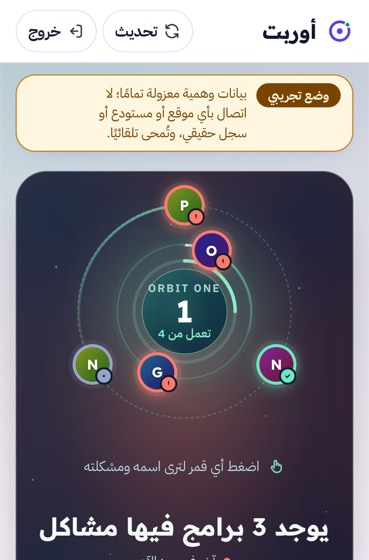 | 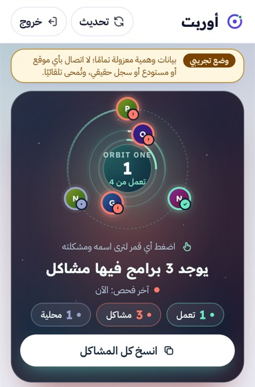 |
| B مطوي عرضي 594×368 | 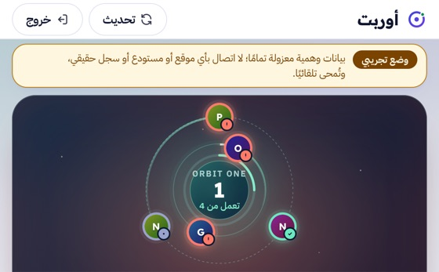 | 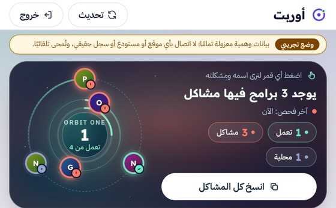 |
| دخول 951×350 | 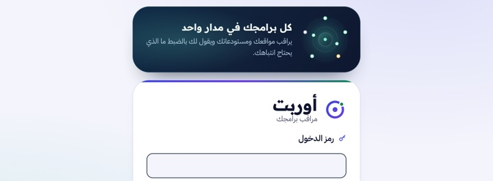 |  |
| E كتاب (محاكاة Chromium) | 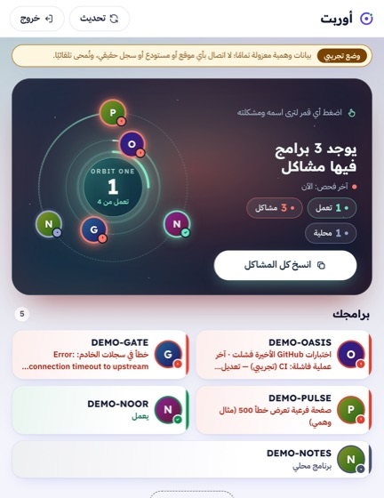 | 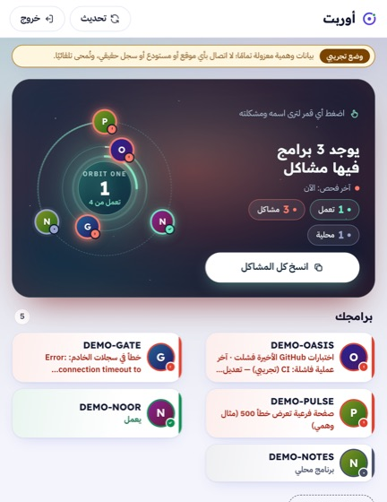 |
| F طاولة، الدخول (محاكاة Chromium) | 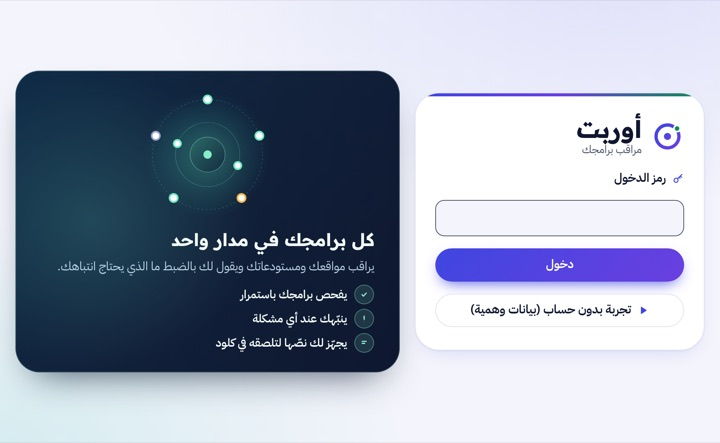 | 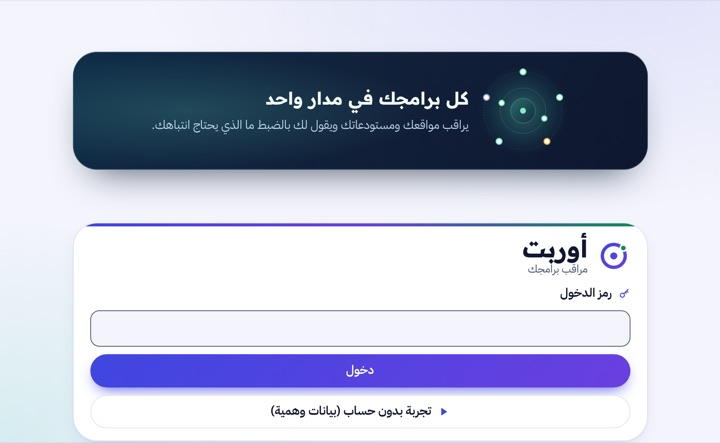 |
| C مفتوح طولي، D مفتوح عرضي (بلا تغيير مقصود) | 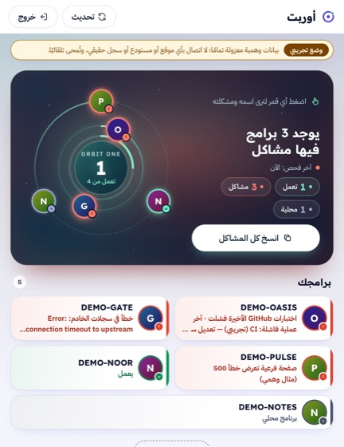 |  |
| J بعد الانتقال إلى 382×580 | | 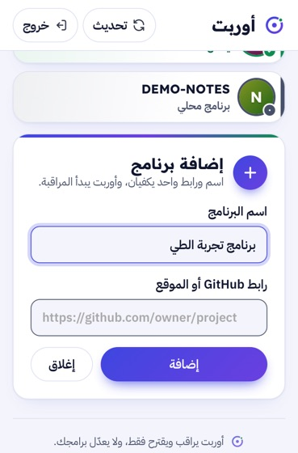 |

## 7. الوصول والاتجاه

- RTL: كل الشاشات `dir=rtl`، والأسماء اللاتينية معزولة (`unicode-bidi: isolate`). PASS.
- التكبير غير مقفول (`width=device-width, initial-scale=1.0, viewport-fit=cover`)، و`touch-action: manipulation`. PASS.
- أهداف اللمس: الأزرار ≥ 44px، وزر إغلاق التفاصيل 36px مرئيًا مع منطقة لمس 44px عبر `::after`. PASS.
- 200% نص (382×580 و669×867): لا تمرير أفقي، وأزرار الشريط تلتف. لكن اسم البرنامج داخل قرص المدار يتجاوز القرص (سلوك سابق). PARTIAL.
- تقليل الحركة: كل الحركات متوقفة تحت `prefers-reduced-motion` (قاعدة سابقة). PASS.
- الوضع الداكن: الشريط ولون شريط النظام متطابقان الآن. PASS.
- VoiceOver حقيقي: NOT_TESTED.

## 8. الأداء

لم تُقَس Core Web Vitals في هذه الجولة: التشغيل المحلي وضع تطوير (Vite middleware)، وقياسه لا يمثل الإنتاج. NOT_TESTED. التعديل CSS فقط (+~70 سطرًا مضغوطة في الحزمة الواحدة)، ولا JavaScript جديد ولا مراقبي resize.

## 9. الاختبارات بعد التعديل

| الأمر | النتيجة |
|---|---|
| `npm run lint` | PASS |
| `npm test` | PASS: 211/211 |
| `npm run build` | PASS (القاعدة `fold-gap` موجودة في CSS المبني) |
| مصفوفة WebKit (سكربت probe في مجلد العمل المؤقت) | 18 مقاسًا × 6 شاشات: 0 تمرير أفقي، 0 أخطاء صفحة |
| محاكاة المفصل (Chromium 156) | الكتاب: 0 عناصر تعبر المفصل في الدخول واللوحة والإضافة (قبل: 3 في الدخول و3 في اللوحة، والإضافة لم تُقَس قبل). الطاولة: الدخول 0 (كان 1) |
| الانتقال الحي (WebKit) | PASS |

## 10. القيود وما يجب فحصه على جهاز حقيقي

1. Safari 27.1: `Viewport Segments` و`Device Posture` خلف علم، فكتلتا الكتاب والطاولة لن تعملا إلا بتفعيله. ودونه يبقى التخطيط العادي الذي اختُبر أعلاه.
2. محاكاة Playwright ليست جهازًا: الحواف غير المتماثلة وعمود Safari الجانبي ولوحة المفاتيح لم تُقَس.
3. على محاكي/جهاز Duo: (أ) المطوي 382×580: هل «انسخ كل المشاكل» ظاهر دون تمرير؟ (ب) المطوي عرضيًا: المدار بجانب الحكم؟ (ج) في الوضع الداكن: هل شريط Safari بلون الشريط العلوي؟ (د) فعّل علم Viewport Segments ثم افتح نصفيًا كالكتاب: هل الفاصل بين المدار والحكم على المفصل؟
4. تطبيق iOS: البناء التالي بـ Xcode 27.2 يكفي لمسار ملء الشاشة. ابنِ ثم افحص الشاشة الداخلية على Device Hub قبل الإرسال. لم يُبنَ هنا.
5. حالة القائمة الفارغة (لا برامج) لم تُصوَّر: العرض التجريبي فيه دائمًا 5 برامج، والدخول الحقيقي يحتاج رمز المشغّل. NOT_TESTED.

## 11. جاهزية Native

الويب هو المنتج. الغلاف Capacitor يحمّل الموقع الحي، فكل ما في هذه الوثيقة يصل إلى التطبيق تلقائيًا. المتبقي أصليًا: بناء بـ iOS 27.1+ SDK، ثم مطابقة `backgroundColor` في [apple/capacitor.config.json](../apple/capacitor.config.json) (`#161C24`) مع `--bg` الداكن (`#080d1c`) إن ظهر فرق عند التحميل. وهذا قرار إصدار تطبيق، فتُرك للمالك.
