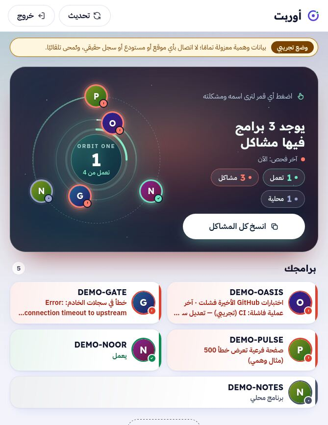
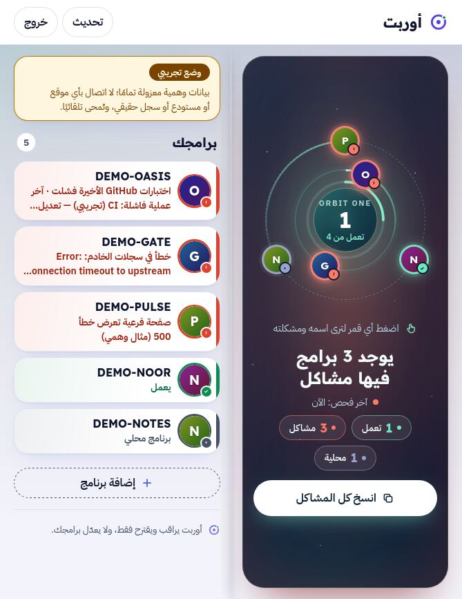
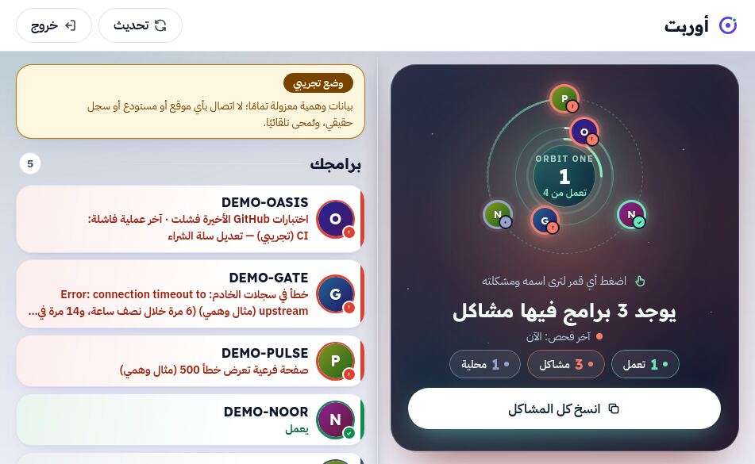
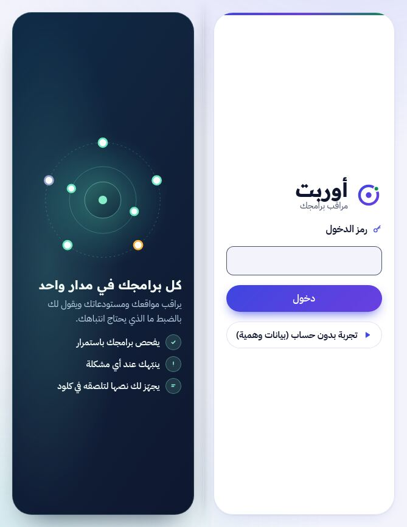
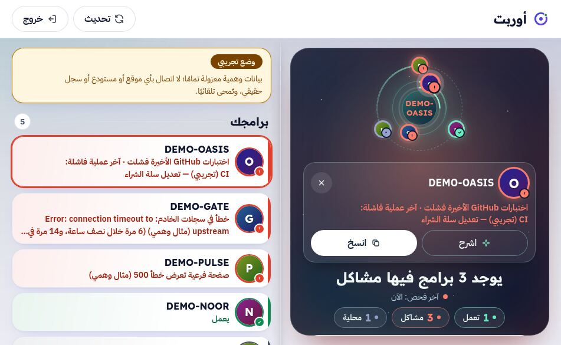
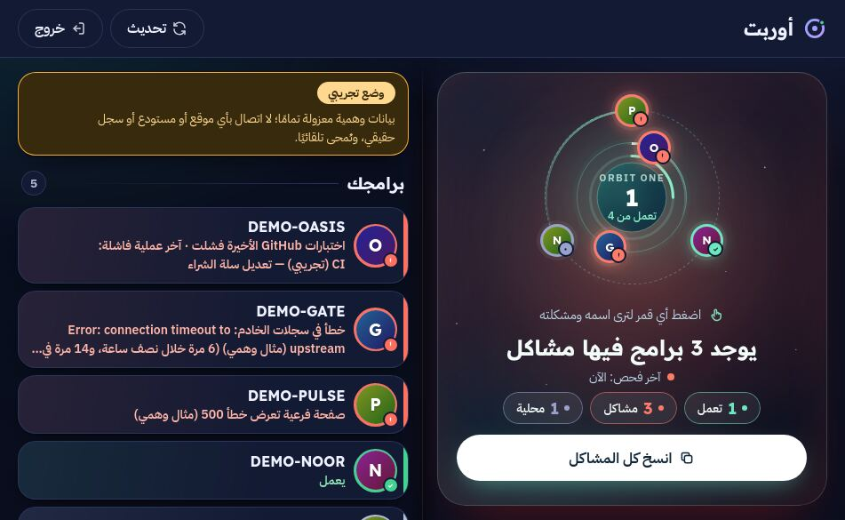
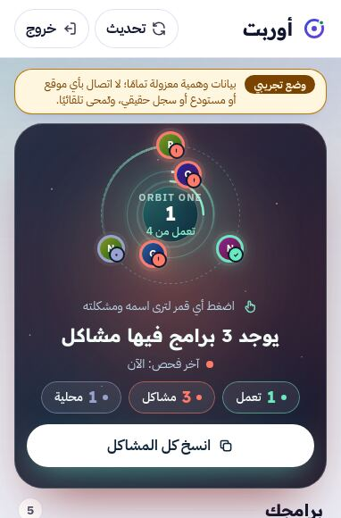
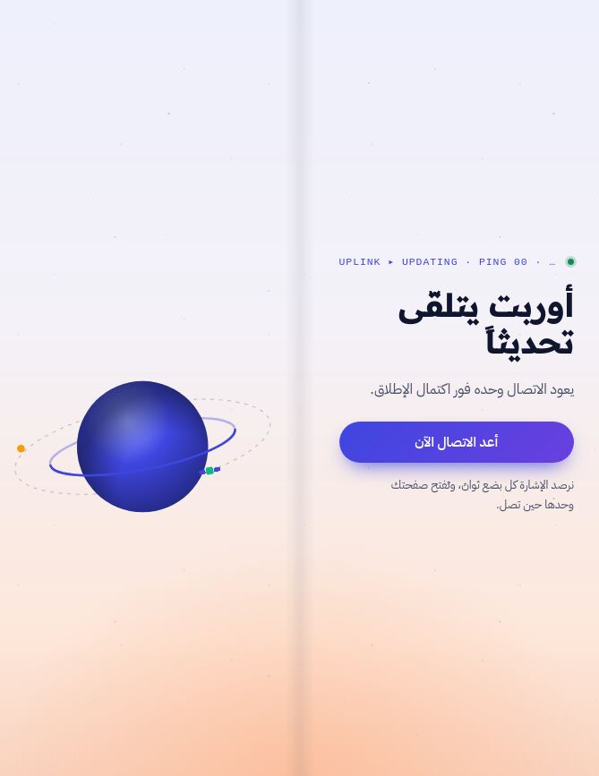

# قبول iPhone Duo النهائي — أوربت (2026-11-14)

الفرع `duo-final-1114`. يبني على `docs/IPHONE-DUO-ADAPTIVE-QUALITY.md` (#71) ولا يعيد فتح ما حُلّ فيه.
كل الأرقام هنا من **Playwright WebKit 26.6 (build 2359) على Linux بمقاسات CSS، DPR 1، تقليل الحركة**، ضد خادم محلي بالوضع التجريبي المعزول ومسارات مُعترضة. **لا يوجد اختبار على جهاز حقيقي**، ولا يُدّعى ذلك.

## 0. ما الذي تغيّر

| المجال | قبل | بعد |
|---|---|---|
| الشاشة الداخلية كتاب (669×867 و951×585) | عمود واحد ممتد: قرص المدار ثم القائمة تحته، والنصوص والأزرار تعبر منتصف الشاشة | **صفحتان حول عمود فقري 32px** (ظل طيّ ناعم وخط شعري يتلاشى عند الطرفين). الصفحة اليمنى (البداية في RTL): لوحة المدار بالحكم وزر النسخ وبطاقة البرنامج المختار، بارتفاع الصفحة كاملًا وثابتة أثناء تمرير الصفحة اليسرى. الصفحة اليسرى: التنبيهات، فهرس البرامج عمودًا هادئًا، أزرار الإضافة/التقرير، نموذج الإضافة، التذييل |
| الدخول على الشاشة الداخلية | بطاقة 440px في الوسط تعبر الطيّ | كتاب: النموذج على اليمين، صورة المنتج ونقاطه الثلاث على اليسار، كلتاهما بطول الصفحة |
| وضع اللابتوب (951×350، 600×350) والمطوي العرضي (594×368) | الشريط أعلى الصفحة يأكل الارتفاع، وفي 600×350 زر النسخ خارج الشاشة الأولى | **الشريط يرسو أسفل الشاشة** (`position: fixed`)، والصفحة تحجز ارتفاعه (`padding-bottom` + `scroll-padding-bottom`)، فلا يغطي آخر سطر ولا الحقل المركّز. الحكم والزر على الشاشة الأولى |
| المفصل الحقيقي | كتلة `horizontal-viewport-segments` منفصلة بشبكة خاصة | الكتلة نفسها تستعمل تخطيط الكتاب، وتضبط `--spine-x` و`--spine` على `env(viewport-segment-*)` ليغطي العمود الفقري المفصل تمامًا (تقدّمي ومعزول) |
| الأقمار | منطقة اللمس 43px عند 382 و38px في الكتاب العرضي | `max(44px, …)`: الشكل كما هو، ومنطقة اللمس ≥44 |
| أصغر هاتف 320×568 | زر النسخ تحت الحافة | المدار يتنازل قليلًا تحت ارتفاع 600، فالزر على الشاشة الأولى |
| 200% نص | أزرار البطاقة والنموذج تُقص | `flex-wrap` على `.detail-actions` و`.actions` |
| صفحة التحديث وسياسة الخصوصية (صفحات ثابتة) | عمود يعبر الطيّ | كتاب: الكلمات يمينًا والكوكب يسارًا (التحديث)، والنص يمينًا والعنوان ثابتًا يسارًا (الخصوصية). وفي اللابتوب: نصف ونصف |

المبدأ: **لا شيء يُعاد تركيبه عند تغيّر المقاس**. التنبيهات انتقلت إلى داخل `Dashboard` في غلاف `.page-aside` يُرسم دائمًا؛ خارج الكتاب يكون `display: contents` وتتقدّم التنبيهات بـ`order: -1` فيبقى ترتيب الهاتف كما كان. كل التخطيط CSS (استعلامات وسائط)، بلا JavaScript جديد ولا مراقبي resize، وبلا `!important` جديد ولا ملف تجميل جديد: القواعد في `src/app.css` في قسم «iPhone Duo final».

حدود الكتاب: `640–720px` عرضًا مع ارتفاع ≥640 (طولي)، أو `820–1000px` مع ارتفاع ≥500 ونسبة ≥7/5 (عرضي)، أو `(horizontal-viewport-segments: 2)`. لذلك iPad 768×1024 و1024×768 يبقيان على التخطيط العريض، و669×520 / 600×480 (نصف مفتوح) على تخطيط الصف الواحد.

## 1. جرد الشاشات (من الكود)

لا يوجد موجّه: `index.html` → `src/main.tsx` → `App.tsx` صفحة واحدة `/` تتبدّل حالتها، إضافة إلى صفحتين ثابتتين في `public/`. كل حالة مرئية هنا صفّ في المصفوفة.

| # | الشاشة | المعرّف في السكربت | كيف وصلنا إليها |
|---|---|---|---|
| 1 | الدخول | `login` | فتح `/` |
| 2 | الدخول: رمز خاطئ | `login-error` | إرسال رمز خاطئ إلى الخادم المحلي |
| 3 | الدخول: الخادم لا يجيب | `login-server-down` | إجهاض `/api/demo/enter` |
| 4 | لوحة المدار | `dash-home` | «تجربة بدون حساب» |
| 5 | بطاقة برنامج فيه مشكلة (اشرح/انسخ/إغلاق) | `dash-detail` | الضغط على بطاقة من الفهرس |
| 6 | بطاقة برنامج يعمل | `dash-detail-ok` | كذلك |
| 7 | الشرح | `dash-explain` | «اشرح» (شرح تجريبي ثابت) |
| 8 | تم النسخ | `dash-copied` | «انسخ كل المشاكل» |
| 9 | النسخ اليدوي (مربع النص) | `dash-manual-copy` | تعطيل الحافظة في الصفحة |
| 10 | نموذج الإضافة | `dash-add` | «إضافة برنامج» + كتابة |
| 11 | نموذج الإضافة: خطأ تحقق | `dash-add-error` | رابط GitHub ناقص |
| 12 | برامج أضفتها + تأكيد الإزالة | `dash-add-mine` | إضافة برنامج في صندوق التجربة ثم «إزالة» |
| 13 | شريط نتيجة «تحديث» | `dash-sync-banner` | «تحديث» |
| 14 | دون اتصال | `dash-offline` | `context.setOffline(true)` |
| 15 | أسطول فارغ / أول تحميل | `dash-empty` | `/api/state` مُعترض بقائمة فارغة |
| 16 | لوحة المشغّل (التنبيهات، تقرير الأسبوع، بلا شريط تجريبي) | `dash-operator` | الجلسة والحالة مُعترضتان من لقطة تجريبية؛ كل طلب كتابة يُجاب محليًا |
| 17 | صفحة «أوربت يتلقّى تحديثًا» | `updating-page` | `/updating.html` مع `/api/version` = 503 |
| 18 | سياسة الخصوصية | `privacy-page` | `/privacy-policy.html` |

غير مستقلة (نفس المكوّن والتخطيط، مغطاة بالصفوف أعلاه): شريط «المراقبة صامتة» وشريط انتهاء التوكن (= `.banner-warn` كما في 14)، رسائل التنبيهات (= شريط 13)، حالات «جارٍ الشرح/تعذر الشرح» (= صندوق 7)، حالات زر تقرير الأسبوع (نص الزر فقط). لا توجد نوافذ حوارية ولا قوائم ولا تبويبات في التطبيق (اختبار CI البصري يفرض ذلك).

## 2. الوضعيات

A مطوي طولي (382×580، 385×571، 320×568) · B مطوي عرضي (594×368) · C كتاب طولي (669×867) · D كتاب عرضي (951×585) · E لابتوب (951×350، 600×350) · F نصف/قصير (669×520، 600×480) · G لوحي/مكتبي (768×1024، 1024×768، 1280×800، 1440×900) · H هواتف مرجعية (360×640، 390×844، 844×390) · S تقسيم الشاشة (320/470/620 × 350/600/900) · I انتقال حي · J ضغط الوصول.

في كل خلية قيس: تمرير أفقي، عناصر مهمة مقصوصة أو خارج الشاشة، أهداف لمس <44px، وفي C/D أي نص أو حقل أو زر أو بطاقة يقطع منطقة المنتصف ±14px (أشد من عرض العمود الفقري الفعلي 32px)، وفي E/B/H-عرضي أن الشريط السفلي لا يغطي آخر محتوى.

## 3. مصفوفة القبول (18 شاشة × A–J)

| الشاشة | A | B | C | D | E | F | G | H | S | I | J |
|---|---|---|---|---|---|---|---|---|---|---|---|
| 1 الدخول | PASS | PASS | PASS | PASS | PASS | PASS | PASS | PASS | PASS | — | PASS |
| 2 رمز خاطئ | PASS | PASS | PASS | PASS | PASS | PASS | PASS | PASS | PASS | — | PARTIAL¹ |
| 3 الخادم لا يجيب | PASS | PASS | PASS | PASS | PASS | PASS | PASS | PASS | PASS | — | PARTIAL¹ |
| 4 لوحة المدار | PASS | PASS | PASS | PASS | PASS | PASS | PASS | PASS | PASS | PASS | PASS² |
| 5 بطاقة مشكلة | PASS³ | PASS | PASS | PASS | PASS | PASS | PASS | PASS | PASS | PASS | PASS² |
| 6 بطاقة تعمل | PASS | PASS | PASS | PASS | PASS | PASS | PASS | PASS | PASS | — | PARTIAL¹ |
| 7 الشرح | PASS⁴ | PASS⁴ | PASS⁴ | PASS⁴ | PASS⁴ | PASS | PASS | PASS | PASS | — | PARTIAL¹ |
| 8 تم النسخ | PASS | PASS | PASS | PASS | PASS | PASS | PASS | PASS | PASS | — | PARTIAL¹ |
| 9 النسخ اليدوي | PASS | PASS | PASS | PASS | PASS | PASS | PASS | PASS | PASS | — | PARTIAL¹ |
| 10 نموذج الإضافة | PASS | PASS | PASS | PASS | PASS | PASS | PASS | PASS | PASS | PASS | PASS (لوحة المفاتيح) |
| 11 خطأ التحقق | PASS | PASS | PASS | PASS | PASS | PASS | PASS | PASS | PASS | — | PARTIAL¹ |
| 12 برامجي + الإزالة | PASS | PASS | PASS | PASS | PASS | PASS | PASS | PASS | PASS | — | PARTIAL¹ |
| 13 شريط التحديث | PASS | PASS | PASS | PASS | PASS | PASS | PASS | PASS | PASS | — | PARTIAL¹ |
| 14 دون اتصال | PASS³ | PASS | PASS | PASS | PASS³ | PASS | PASS | PASS | PASS | — | PARTIAL¹ |
| 15 أسطول فارغ | PASS | PASS | PASS | PASS | PASS | PASS | PASS | PASS | PASS | — | PARTIAL¹ |
| 16 لوحة المشغّل | PASS | PASS | PASS | PASS | PASS | PASS | PASS | PASS | PASS | — | PARTIAL¹ |
| 17 صفحة التحديث | PASS | PASS | PASS | PASS | PASS | PASS | PASS | PASS | PASS | — | PARTIAL¹ |
| 18 الخصوصية | PASS⁵ | PASS⁵ | PASS⁵ | PASS⁵ | PASS⁵ | PASS⁵ | PASS⁵ | PASS⁵ | PASS⁵ | — | PARTIAL¹ |
| المفصل الحقيقي (كل الشاشات) | — | — | NOT_TESTED⁶ | NOT_TESTED⁶ | — | — | — | — | — | — | — |

1. تقليل الحركة مُطبّق في كل القياسات (468 قياسًا). الوضع الداكن و200% نص وحواف الأمان غير المتماثلة قيست على الدخول واللوحة والبطاقة ونموذج الإضافة فقط (59 قياسًا، 0 مخالفات)، وبقية الشاشات تستعمل المكوّنات نفسها لكنها لم تُقَس بهذه الضغوط.
2. في 200% نص يلتفّ الشريط إلى سطرين في الكتاب الطولي، فعند التمرير تمرّ اللوحة اليمنى الثابتة تحت الشريط بمقدار الفرق، واسم البرنامج داخل قرص المدار يتجاوز القرص (سلوك سابق). القياس: 0 تمرير أفقي، 0 عبور للمنتصف، 0 قصّ.
3. زر «انسخ كل المشاكل» ينزل تحت الشاشة الأولى حين تظهر البطاقة أو شريطان؛ البطاقة نفسها تحمل «انسخ» لهذا البرنامج، والحكم (`h1`) يبقى ظاهرًا.
4. الشرح يطيل اللوحة: في الكتاب تمرَّر اللوحة اليمنى داخليًا (هوامش تلقائية تُبقي أعلاها قابلًا للوصول)، وفي A/B/E تتحرك الصفحة إلى الشرح.
5. رابطان داخل النص (`orbitq8.web.app`، البريد) ارتفاعهما 20px: روابط داخل جملة، مستثناة في WCAG 2.5.8. القائمة الوحيدة في «أهداف لمس صغيرة».
6. WebKit لا يحاكي `viewport segments`. الكتلة التقدّمية موجودة ولم تُشغَّل في أي محرك هذه الجولة.

## 4. الأرقام (التقرير الكامل `docs/iphone-duo-final/audit-report.json`)

| المقياس | النتيجة |
|---|---|
| قياسات المصفوفة | 468 = 18 شاشة × 26 مقاسًا |
| أخطاء تنفيذ في السكربت | 0 |
| تمرير أفقي (`scrollWidth > clientWidth`) | 0 |
| عناصر مهمة مقصوصة/خارج الشاشة | 0 |
| أهداف لمس <44px | 0 في التطبيق؛ 2 روابط داخل نص في صفحة الخصوصية (ملاحظة 5). قبل: الأقمار 43×43 (A) و38×38 (D) |
| عبور منطقة الطيّ (C, D، ±14px) | 0 (قبل: كل شاشات الكتاب، بما فيها حقل الدخول وأزرار الدخول وبطاقات الفهرس والشريط التجريبي) |
| الكتاب مطبّق حيث يجب | 100% من شاشات C/D |
| الشريط السفلي يغطي محتوى (E, B, 844×390) | 0px |
| أخطاء الصفحة | 1 فقط: `WebSocket closed without opened` من عميل Vite عند محاكاة انقطاع الشبكة — أثر وضع التطوير، ليس من التطبيق |
| I انتقال حي 951×585 → 669×867 → 470×700 → 382×580 → 594×368 → 951×350 → 951×585 | **PASS**: النص المكتوب في الحقلين، التحديد داخل الرابط (8–15)، البرنامج المختار وبطاقته، والنموذج المفتوح بقيت كلها؛ 0 تمرير أفقي. موضع التمرير لا يُصفَّر (120 → 799 → 835 → 769 → 516) لكنه يتبع إعادة التدفق، كما في أي صفحة |
| J 200% نص (382×580، 669×867، 951×585، 951×350) | 16 قياسًا، 0 مخالفات (ملاحظة 2) |
| J الوضع الداكن (نفس المقاسات) | 16، 0 |
| J حواف أمان غير متماثلة (يسار 44 / يمين 44، بتجاوز `--gut-l/--gut-r`) | 24، 0: العمود الفقري يبقى في منتصف الشاشة لأن عمودي الشبكة محسوبان من `50vw` وليس من عرض المحتوى |
| J لوحة المفاتيح (التركيز في حقل الاسم ثم الارتفاع 350) | 3/3: الحقل يحتفظ بالتركيز والنص، ظاهر، وغير مغطّى بالشريط السفلي (بعد `scrollIntoView` الذي يفعله Safari بنفسه) |
| J تقليل الحركة | كل القياسات؛ القاعدة السابقة توقف كل الحركات، ولم تُضف حركة جديدة |

## 5. صور قبل/بعد (WebKit، DPR 1)

| | قبل | بعد |
|---|---|---|
| C كتاب طولي 669×867 — اللوحة |  |  |
| D كتاب عرضي 951×585 — اللوحة |  |  |
| C الدخول 669×867 |  |  |
| E لابتوب 951×350 |  |  |
| D بطاقة برنامج | |  |
| D داكن | |  |
| A مطوي 382×580 | |  |
| C صفحة التحديث | |  |

راجعتُ بنفسي لقطات كل الشاشات الـ18 في 669×867 و951×585 و951×350 و600×350 و594×368 و382×580 (و669×520 و768×1024) قبل كتابة هذا الملف.

## 6. الاختبارات

| الأمر | النتيجة |
|---|---|
| `npm run lint` (tsc) | PASS |
| `npm test` | PASS 211/211 |
| `npm run build` | PASS |
| `node --check scripts/duo-final-audit.mjs` | PASS |
| CI على `main` قبل الفرع (`f89a89b`) | quality gate وvisual smoke: نجاح، فلا فشل سابق |

## 7. إعادة التدقيق

```bash
DISABLE_HMR=true PORT=5150 npm run dev        # خادم محلي، الوضع التجريبي مفعّل افتراضيًا
PW_MODULE=/opt/node22/lib/node_modules/playwright/index.mjs PLAYWRIGHT_BROWSERS_PATH=/opt/pw-browsers \
  node scripts/duo-final-audit.mjs http://127.0.0.1:5150 test-artifacts/duo-final
```
`DISABLE_HMR=true` لازم إذا كان منفذ HMR الافتراضي مشغولًا. السكربت يحجب Service Worker (وإلا استولى على وحدات Vite في WebKit)، ويعطي كل سياق عنوان `x-forwarded-for` خاصًا لأن بوابة التجربة المحلية تسمح بـ20 دخولًا لكل عنوان في 15 دقيقة. `DUO_SIZES=669x867,951x585` و`DUO_ONLY=dash-home,login` و`DUO_SHOTS_ONLY=1` لتضييق التشغيل. المدة ~40 دقيقة على جهاز مشغول.

## 8. المشكلات المتبقية

- **P0**: لا شيء معروف.
- **P1**: لم يُختبر على iPhone Duo حقيقي: ارتفاع Safari الفعلي في الوضع العرضي (أشرطة المتصفح) قد ينزل تحت 500px فيخرج من الكتاب إلى صف واحد. هذا تراجع آمن (تخطيط مختبر) لكنه يستحق نظرة.
- **P2**: في 200% نص يلتفّ الشريط فتمرّ اللوحة اليمنى تحته عند التمرير في الكتاب الطولي؛ اسم البرنامج في قرص المدار يتجاوزه (سابق).
- **P2**: الكتاب العرضي مع شرح مفتوح: اللوحة اليمنى تُمرَّر داخليًا والمدار يصغر إلى 168px.
- **P2**: صفحة الخصوصية: روابط داخل النص 20px (مستثناة).
- **NOT_TESTED**: المفصل الحقيقي (viewport segments)، VoiceOver، لوحة مفاتيح حقيقية، حواف أمان فعلية، الأداء (Web Vitals) — التشغيل المحلي وضع تطوير.

## 9. قائمة المالك على الجهاز

1. افتح أوربت على الشاشة الداخلية طوليًا: صفحتان، والطيّ يقع بين لوحة المدار يمينًا والفهرس يسارًا، ولا كلمة على الطيّ.
2. اقلب الجهاز عرضيًا: ما زالت صفحتين؟ إن صار صفًا واحدًا فأرسل ارتفاع النافذة (أشرطة Safari).
3. مرّر الفهرس: لوحة المدار تبقى ثابتة. اضغط برنامجًا: تظهر بطاقته يمينًا دون قفزة.
4. افتح «إضافة برنامج»، اكتب اسمًا، ثم اطوِ الجهاز وافتحه: النص باقٍ.
5. نصف إغلاق (لابتوب): الشريط في الأسفل، والحكم والزر فوقه، ولا يغطي الشريط الحقل عند الكتابة.
6. مطوي: الحكم وزر النسخ على الشاشة الأولى.
7. الدخول على الشاشة الداخلية: النموذج يمينًا والصورة يسارًا.
8. الوضع الداكن: الطيّ ظل خفيف، لا خط أبيض صارخ.
